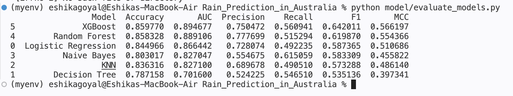

🌦️ Rain Prediction in Australia Using Machine Learning

A machine learning project that predicts whether it will rain the following day in Australia using historical weather data. The project implements and compares five classification algorithms and provides an interactive Streamlit web application for making predictions.

⸻

👩‍🎓 STUDENT INFO

NAME: Eshika Goyal

BITS ID: 2026AJ05336

BITS EMAIL: 2026aj05336@wilp.bits-pilani.ac.in

APP LINK: [Rain Fall Prediction in Aus by Eshika Goyal] :

DATA SOURCE: https://www.kaggle.com/datasets/jsphyg/weather-dataset-rattle-package?select=weatherAUS.csv

⸻

📌 a) Problem Statement

Weather forecasting plays an important role in agriculture, transportation, tourism, and everyday decision-making.

The objective of this project is to develop a machine learning classification system that predicts whether it will rain the next day (RainTomorrow) based on historical weather observations across different locations in Australia.

The project explores multiple classification algorithms, evaluates their performance using standard metrics, and identifies the most suitable model for rain prediction.

🤖 b) Models Used and Performance Comparison

Five classification algorithms were implemented and evaluated:

1. Logistic Regression
2. Decision Tree Classifier
3. K-Nearest Neighbors (KNN)
4. Gaussian Naive Bayes
5. Support Vector Machine (SVM)

The models were evaluated using the following performance metrics:

* Accuracy: Overall proportion of correctly classified observations.
* Precision: Proportion of predicted rainy days that were actually rainy.
* Recall: Proportion of actual rainy days correctly identified.
* F1 Score: Harmonic mean of precision and recall.
* ROC-AUC: Ability of the model to distinguish between the two classes.
* MCC: Matthews Correlation Coefficient, which considers all four confusion-matrix outcomes.

⸻

📈 c) Comparison Table

The following table presents the performance of all five models on the test dataset.

Model	Accuracy	Precision	Recall	F1 Score	ROC-AUC	MCC
🥇 Logistic Regression	84.50%	72.81%	49.22%	58.74%	0.8664	0.5107
🥈 Support Vector Machine	84.49%	72.95%	48.99%	58.61%	0.8664	0.5101
🥉 Naive Bayes	80.30%	55.47%	61.51%	58.33%	0.8270	0.4558
KNN	83.63%	68.97%	49.05%	57.33%	0.8271	0.4861
Decision Tree	78.68%	52.32%	55.00%	53.63%	0.7026	0.3981

📊 Model Performance Visualization

The following visualization provides a graphical comparison of the performance of all five classification models.

  

⸻

🔍 d) Observations on Model Performance

Based on the evaluation results:

* Logistic Regression achieved the highest F1 Score of 58.74% and the highest MCC of 0.5107, making it the best-performing model overall based on the F1 Score.
* Support Vector Machine (SVM) performed very similarly to Logistic Regression, achieving an accuracy of 84.49%.
* Naive Bayes achieved the highest recall of 61.51%, indicating that it identified a larger proportion of actual rainy days.
* KNN delivered reasonably good accuracy and precision but had a comparatively lower recall.
* Decision Tree achieved the lowest ROC-AUC and F1 Score among the five models.

Overall, Logistic Regression provided the best balance of precision and recall, while Naive Bayes was more effective at identifying rainy days.

⸻

⚙️ How to Run

1. Clone the repository

git clone https://github.com/eshika-09/Rain-Prediction-Australia-ML.git
cd Rain-Prediction-Australia-ML

2. Create and activate virtual environment

python3 -m venv myenv
source myenv/bin/activate

3. Install dependencies

pip install -r requirements.txt

🔄 Project Workflow

1️⃣ Train the Models

python model/train_models.py

Trains the five machine learning models and saves them in the trained_models/ folder.

2️⃣ Evaluate the Models

python model/evaluate_models.py

Evaluates all five models and saves their performance metrics in model_comparison.csv.

3️⃣ Run the Streamlit Application

streamlit run app.py

Launches the web application where users can enter weather details and get next-day rain predictions.

⸻

📁 Project Structure

Rain_Prediction_in_Australia/
│
├── 📂 dataset/
│   ├── test_sample.csv
│   └── weatherAUS.csv
│
├── 📂 model/
│   ├── preprocessing.py
│   ├── train_models.py
│   ├── evaluate_models.py
│   └── create_test_sample.py
│
├── 📂 trained_models/
│   ├── logistic_model.pkl
│   ├── decision_tree_model.pkl
│   ├── knn_model.pkl
│   ├── naive_bayes_model.pkl
│   ├── svm_model.pkl
│   ├── scaler.pkl
│   ├── encoders.pkl
│   ├── num_imputer.pkl
│   ├── cat_imputer.pkl
│   ├── feature_columns.pkl
│   ├── test_data.pkl
│   └── model_comparison.csv
│
├── 📄 app.py
├── 📄 requirements.txt
├── 📄 README.md
├── 📄 output_metric.txt
├── 🖼️ image.png
└── 📄 .gitignore

⸻

💾 INFO

The trained_models/ directory contains the saved machine learning models and preprocessing objects.

The .pkl files are generated using Joblib and are used by the Streamlit application to load trained models without requiring retraining every time the application is launched.

The project uses Git LFS (Large File Storage) to manage large model files.

⸻

🛠️ Technologies Used

* Python – Core programming language
* NumPy – Numerical computations
* Pandas – Data manipulation and analysis
* Scikit-learn – Machine learning algorithms and evaluation
* Matplotlib & Seaborn – Data visualization
* Streamlit – Interactive web application
* Git & Git LFS – Version control and large file management

⸻

⭐ Project Summary

This project demonstrates the application of supervised machine learning techniques to a real-world weather prediction problem. By implementing and comparing five classification algorithms, it highlights the importance of evaluating models using multiple performance metrics rather than accuracy alone.

Developed as part of the M.Tech in Artificial Intelligence and Machine Learning programme at BITS Pilani.
